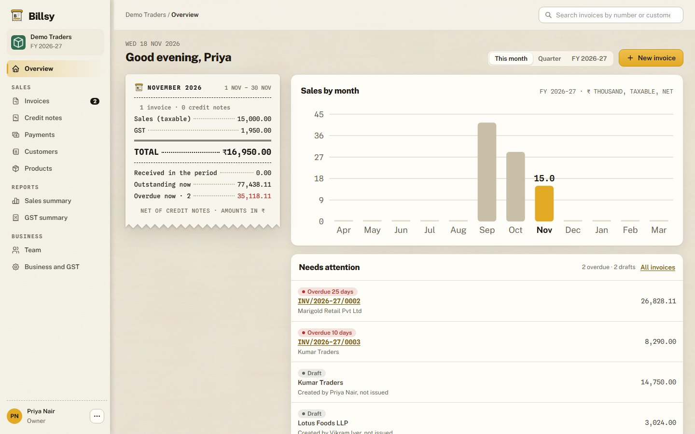
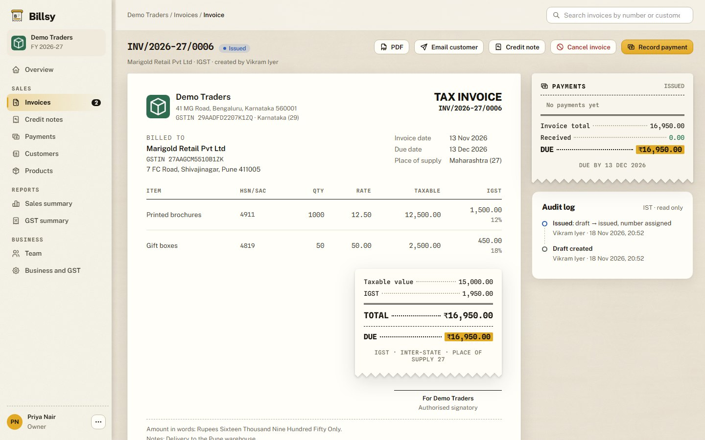
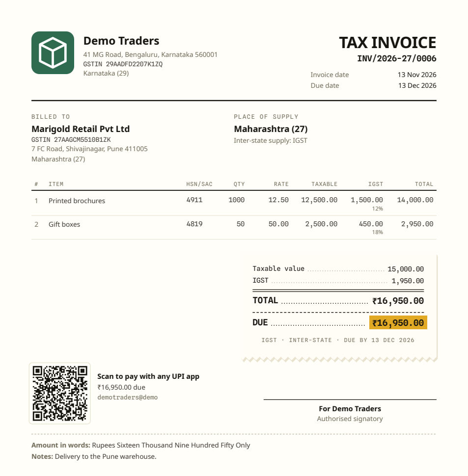

# Billsy

[](https://github.com/Pavithiran21/Billsy/actions/workflows/ci.yml)

**Live demo: [billsy-gst.vercel.app/demo](https://billsy-gst.vercel.app/demo)** (log in as an Owner, an Accountant or Staff in one click). It runs on free hosting, so the first load after a quiet spell can take about a minute.

GST billing and invoicing for small Indian businesses. An owner registers the business with its GSTIN and state, invites staff and an accountant, and issues GST-correct invoices with PDFs emailed to customers. Billsy tracks payments and credit notes, and hands the accountant clean sales and GST reports.

**Node · Express 5 · MySQL 8.4 · Knex · React 19 · Redux Toolkit / RTK Query · Tailwind CSS 4 · Playwright**



**What's hard here**

- **Money to the paisa.** `DECIMAL` columns and `decimal.js`, never floats. GST is rounded per line and SGST = GST − CGST, so the halves always add up ([gst.js](backend/src/modules/gst/gst.js)).
- **Invoice numbers with no gaps, even when ten are issued at the same moment.** The number is taken inside the issuing transaction under a `SELECT … FOR UPDATE` row lock and rolls back with it ([numbering.js](backend/src/modules/invoices/numbering.js)).
- **Nothing issued is ever edited.** An issued invoice is paid, cancelled or corrected with a credit note, and every change writes an audit row in the same transaction.

| Invoice | PDF with a UPI "Scan to pay" QR |
|---|---|
|  |  |

## Signature feature: GST-correct invoicing

**Exact money and rounding by the rule book.** Every amount is a MySQL `DECIMAL` column, and the arithmetic uses `decimal.js`, never JavaScript floats. GST is calculated **per line** on the taxable value (price × quantity − discount) and rounded half up to the paisa. For a same-state sale the line's CGST is half the GST, rounded, and **SGST = line GST − CGST**, so the two always add up (a 1.01 GST line becomes 0.51 + 0.50). Invoice totals are plain sums of the rounded lines, with no extra round-off line (`backend/src/modules/gst/gst.js`).

**CGST + SGST or IGST from the place of supply.** The tax split comes from comparing the seller's state with the place of supply, not from anything the user types.

**Gap-free numbers, even under concurrent issuing.** Invoices are numbered `INV/2026-27/0001` and credit notes `CN/2026-27/0001`, per business and Indian financial year (1 April – 31 March). The number is taken only when a draft is **issued**, so drafts never leave gaps. `takeNextNumber` (`backend/src/modules/invoices/numbering.js`) locks the business's sequence row with `SELECT … FOR UPDATE` inside the issuing transaction:
- two issues can never read the same next value; the second waits for the first;
- if the transaction rolls back, the increment rolls back with it, so no number is lost;
- a document date earlier than the last numbered one is refused (422), so numbers and dates run in the same order.

**Nothing issued is ever edited or deleted.** An issued invoice can be paid, cancelled (Owner only, and only while nothing has been paid or credited) or corrected with a **credit note**. A credit note has its own gap-free numbering and links to the original. On a line's final partial credit, the amounts are "what is left of the line", so rounding can never credit a paisa more than was billed. Every state change and every credit note writes an **audit log** row in the same transaction.

## Features

- Sign up a business (name, GSTIN, address, state, logo stored as `LONGBLOB`), invite team members by email (single-use, 7-day link); each user belongs to one business
- Customers (optional GSTIN and state) and products or services (HSN/SAC code, price, GST rate)
- Invoices with line items and discounts: draft, issued, paid or cancelled, with part-paid and overdue shown on screen
- Payments, including partial payments, with the outstanding amount always known
- Credit notes, full or partial
- PDF invoices and credit notes generated with PDFKit (no headless browser), emailed to the customer with the PDF attached
- **UPI "Scan to pay" QR** on unpaid invoice PDFs: with a UPI ID in Business and GST settings, the PDF carries a `upi://pay` QR for the exact amount still due, which any UPI app (GPay, PhonePe, Paytm, BHIM) can read. It disappears once the invoice is paid or cancelled ([upiPayment.js](backend/src/modules/invoices/upiPayment.js))
- Sales summary and GST summary by period, net of credit notes, with CSV export
- Password reset by email; a business can be deactivated but never hard-deleted, because issued invoices must be kept

## Roles (all scoped to one business)

| Role | Can | Cannot |
|------|-----|--------|
| Owner | Everything Staff can, plus manage the business, GST settings and team, cancel issued invoices, issue credit notes | Cancel an invoice once money has been received or credited; delete an issued invoice |
| Staff | Manage customers and products, create and issue invoices, record payments, delete their own drafts | Cancel invoices, issue credit notes or change settings (403) |
| Accountant | Read invoices, credit notes, payments and reports; export CSV | Create or change anything (403) |

Every query is scoped to the user's own business; another business's records answer 404.

## Tech stack

| Layer | Choice |
|-------|--------|
| Backend | Node 26, Express 5, Knex 3 with migrations + mysql2 (MySQL 8.4), decimal.js, Zod 4, PDFKit, multer, jsonwebtoken, bcryptjs, Nodemailer, pino, helmet, express-rate-limit, Luxon |
| Frontend | React 19, Vite 8, **Redux Toolkit + RTK Query**, React Router 8, React Hook Form + Zod, decimal.js, Tailwind CSS 4, Tabler icons |
| Email | Any SMTP server: Ethereal for development, Brevo for real mail |

## Project structure

```
backend/
  migrations/            Knex migrations: accounts, catalog, invoicing
  src/
    modules/
      gst/               gst.js (line maths, rounding, credit amounts), state data, amount in words
      invoices/          invoice.service, invoiceRules (who may do what in which state), numbering
      creditNotes/ payments/ customers/ products/ business/ team/
      reports/           sales and GST summaries, dashboard
      pdf/               PDFKit layout and fonts
      audit/             the audit trail
      auth/ users/ mail/ demo/ meta/
    db/                  knex, transaction helper
  scripts/               db:create, seed:dev, seed:demo, seed:test, make-env, ethereal:new
frontend/src/            store (Redux Toolkit), api (RTK Query), features/, components/ ...
e2e/                     Playwright: tests/api (request client) and tests/ui (browser), helpers, prepare.js
.github/workflows/       CI: lint, build, the Playwright suite against MySQL 8.4, and the Docker image
Dockerfile               one image: the API also serves the built frontend (one origin)
```

## Run locally

**You need** Node 26.12 or later and MySQL 8.4.

Create `backend/.env`:

| Variable | What it is |
|----------|------------|
| `SMTP_HOST`, `SMTP_PORT`, `SMTP_USER`, `SMTP_PASS`, `SMTP_FROM` | Outgoing mail |
| `DB_HOST`, `DB_PORT`, `DB_NAME`, `DB_USER`, `DB_PASSWORD` | MySQL connection; `DB_NAME` must be `billsy` (the code accepts only `billsy`, `billsy_test` and `billsy_demo`) |
| `PORT` | API port (4000) |
| `FRONTEND_URL` | `http://localhost:5173`, used in email links and CORS |
| `LOG_LEVEL` | pino log level |
| `JWT_SECRET` | Signs access tokens (at least 32 characters) |
| `TIME_OVERRIDE_ENABLED` | `true` lets a request pin "now" with a header; development only |
| `RATE_LIMITS_ENABLED` | `true` |
| `DEMO_MODE` | `true` enables the `/demo` page |
| `DEMO_PASSWORD` | Password given to the seeded accounts |
| `DEMO_SMTP_HOST`, `DEMO_SMTP_PORT`, `DEMO_SMTP_USER`, `DEMO_SMTP_PASS`, `DEMO_SMTP_FROM` | Inbox for mail to `.test` addresses, so demo mail never goes to a real server |
| `TRUST_PROXY` | Optional. `loopback` (default) or the number of proxies in front, e.g. `1` on Render, so rate limits key on the visitor's IP |
| `STATIC_DIR` | Optional. A built `frontend/dist`; the API then serves the app too (the Docker image sets it) |
| `DB_SSL_CA` | Optional. The CA certificate (PEM) of a hosted MySQL that requires TLS, such as TiDB Cloud (ISRG Root X1) |

Then:

```powershell
cd backend
npm ci
npm run db:create       # creates the billsy database if it doesn't exist
npm run migrate         # Knex migrations
npm run seed:dev        # empties billsy and builds two sample businesses
npm run dev             # API on http://localhost:4000

cd ..\frontend
npm ci
npm run dev             # app on http://localhost:5173 (Vite proxies /api)
```

The dev seed builds **Kaveri Studio** (Owner `dev@billsy.test`, Accountant `meera@kaveri.billsy.test`, Staff `ravi@kaveri.billsy.test`) and **Demo Traders** (the demo accounts below). Every account uses the password in `DEMO_PASSWORD`.

**Or with Docker** (MySQL included, no `.env` needed):

```powershell
docker compose up --build
docker compose exec app npm run seed:dev   # then open http://localhost:4000/demo
```

## Demo accounts

With `DEMO_MODE=true`, **http://localhost:5173/demo** offers **Log in as Owner / Accountant / Staff**, all in Demo Traders.

| Role | Email | What to try |
|------|-------|-------------|
| Owner | `owner@demo.billsy.test` | Look at Business and GST settings, invite an Accountant, issue a same-state invoice and email it with its PDF, issue and cancel an inter-state (IGST) invoice, issue a partial credit note, read the GST summary. Blocked: a part-paid invoice can't be cancelled. |
| Accountant | `accountant@demo.billsy.test` | Browse invoices, credit notes and payments, run the sales and GST summaries for the financial year, export CSV, open an invoice's PDF. Blocked: New invoice says "Accountants have view-only access." |
| Staff | `staff@demo.billsy.test` | Add a customer and a product, create a draft, issue it, record a part payment, delete their own draft. Blocked: no Cancel or Credit note, and business settings are Owner-only. |

Demo accounts cannot change their email or password or delete the business.

## Testing

**Playwright only**, in [`e2e/`](e2e): API tests with Playwright's `request` client and browser tests for the three roles, against a real MySQL 8.4 (`billsy_test`) and a real Ethereal inbox. CI runs them on every push.

- **33 tests**: 25 API and 8 browser.
- **GST maths:** the 1.01 → 0.51 + 0.50 split, IGST for an inter-state sale, discounts, and totals that are plain sums of the rounded lines.
- **Concurrency:** ten drafts issued at the same moment get `0001`–`0010`, each once. Five payments sent at once with the same version save exactly one; the other four get 409.
- **Rules and access:** a deleted draft leaves no gap, a backdated issue is refused (422), issued invoices are never edited or deleted, the Accountant gets 403 on writes, Staff can't cancel or credit, and another business's invoice, customer and PDF answer 404.
- **UPI QR:** the ID is validated and Owner-only, and the PDF carries the QR only while money is due.
- **Email:** the password-reset mail is read from the Ethereal inbox over IMAP, and its link sets a new password that then logs in.

Every test claims its own business from a seeded pool of 3,000 (an atomic lock file per slot), so tests run in parallel and each one's invoice numbers start at `0001`. Requests pin "now" with an `X-Test-Now` header (refused in production), so the financial year and dates are the same on any day.

```powershell
cd e2e
npm ci
npx playwright install chromium
npm test        # writes .env.test, creates and seeds billsy_test, starts the API and app on their own ports, runs everything
```

## Deploy

The frontend runs on [Vercel](https://vercel.com) and the API on [Render](https://render.com), and the browser still sees one origin: [`frontend/vercel.json`](frontend/vercel.json) forwards `/api/*` to the Render service, so the refresh cookie (SameSite=Strict) works with no CORS or cross-site cookies.

- **Frontend (Vercel):** import the repository, set the Root Directory to `frontend` (framework Vite, build `npm run build`, output `dist`). `vercel.json` also sends every other path to `index.html` for React Router and sets the page's security headers. If the Render service is renamed, change its URL in `vercel.json`.
- **API (Render):** one free web service from `Dockerfile.api` (see [`render.yaml`](render.yaml)). Migrations run on every start. The full `Dockerfile` (API plus built frontend on one origin) is what `docker-compose.yml` and CI use.

- **Database:** [TiDB Cloud Starter](https://www.pingcap.com/tidb-cloud-starter/) (free, MySQL 8.0 compatible, runs in pessimistic mode like InnoDB). Create a `billsy_demo` database, set `DB_*` and `DB_SSL_CA` (the ISRG Root X1 certificate), and allow access from anywhere so Render can connect. The numbering depends on row locks (`SELECT ... FOR UPDATE`); the API specs, including ten invoices issued at the same moment and five simultaneous payments, pass on TiDB. A plain MySQL 8 also works.
- **Settings:** `NODE_ENV=production`, `TRUST_PROXY=2` (Vercel, then Render's proxy), `DEMO_MODE=true`, `FRONTEND_URL` = the Vercel URL, and SMTP for real mail (Brevo) plus `DEMO_SMTP_*` (Ethereal) for the demo accounts' mail.
- **Demo data:** free Render services have no Shell, so run `npx knex migrate:latest` and `npm run seed:demo` once from your own machine, with `ENV_FILE` pointing at an env file that has the TiDB `DB_*` values and `DB_NAME=billsy_demo`.

Free services sleep after 15 minutes without traffic, so the first visit after that takes about a minute.

**Email on free hosting:** Render's free web services block outbound SMTP (ports 25, 465 and 587), so "Email invoice" answers "Email not sent" on the live demo. Issuing, payments, credit notes, PDFs and reports all work. Emails work when you run Billsy locally or on a paid instance.

## Demo videos

- `Billsy-full-workflow.webm`: an Owner signs up a business and invites the team, Staff issue a CGST + SGST invoice (showing the rounding) and an IGST invoice and record a part payment, the Owner issues a credit note, emails the invoice and cancels one, and the Accountant reads the audit log, the GST summary and the CSV
- `Billsy-owner-demo.webm`, `Billsy-accountant-demo.webm`, `Billsy-staff-demo.webm`: one walkthrough per role

<!-- To embed: edit this README on GitHub and drag the .webm files from the workspace videos/ folder here. -->

## License

Copyright (c) 2026 R.Pavithiran. All rights reserved. The source is public so you can read it and see how it is built. Please ask before copying, reusing or redistributing it.
